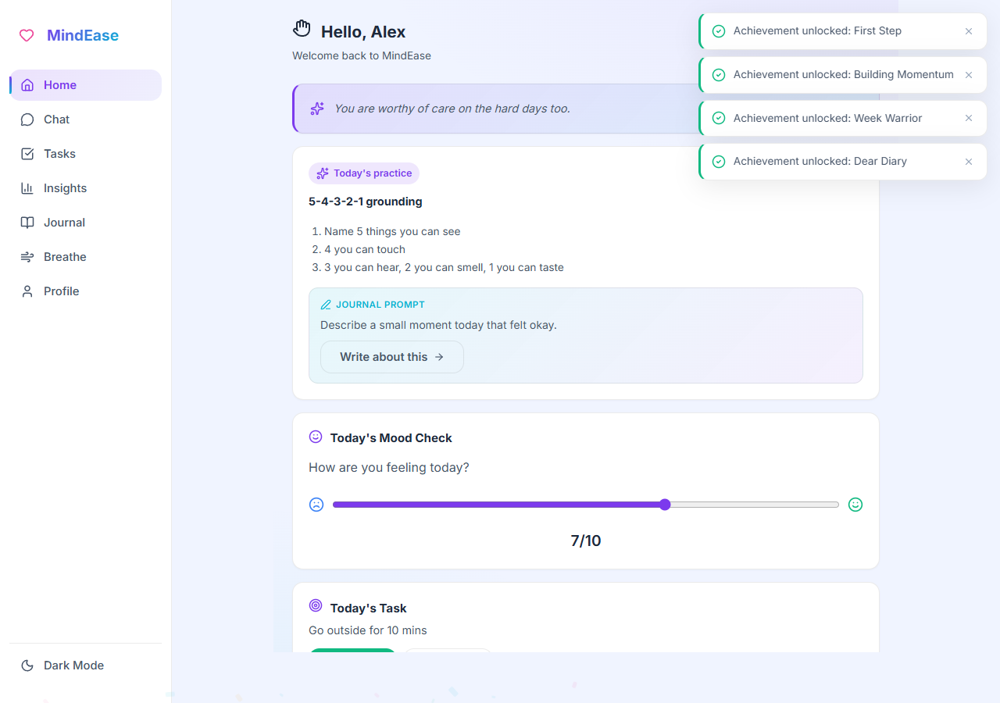
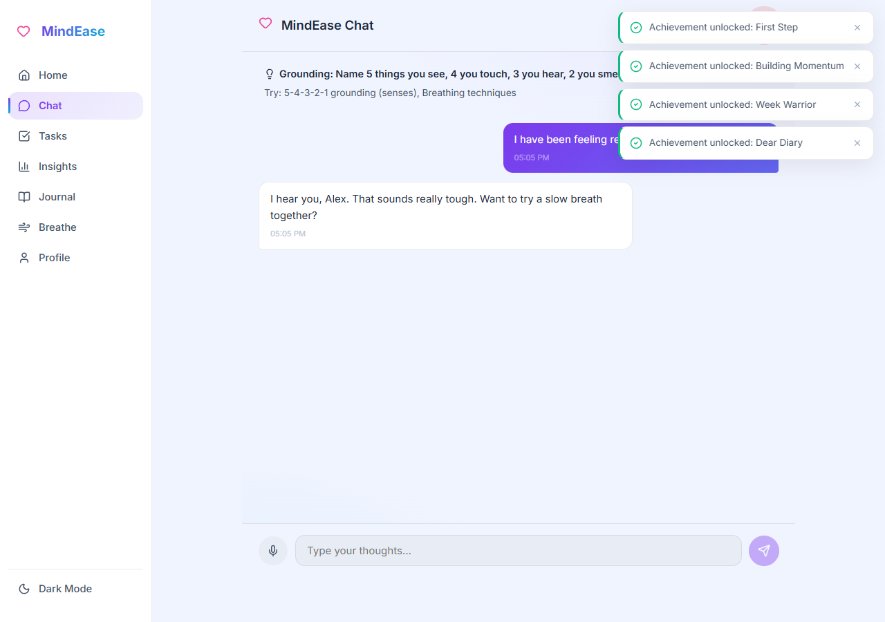
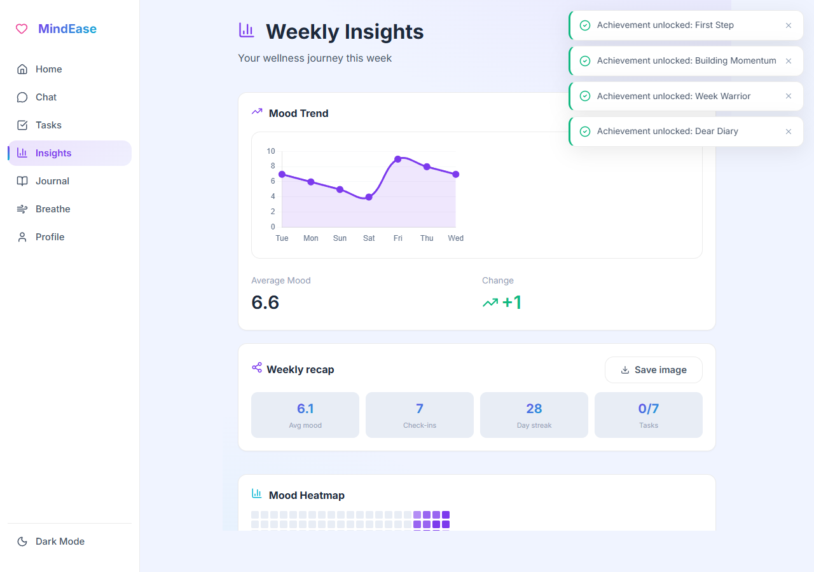
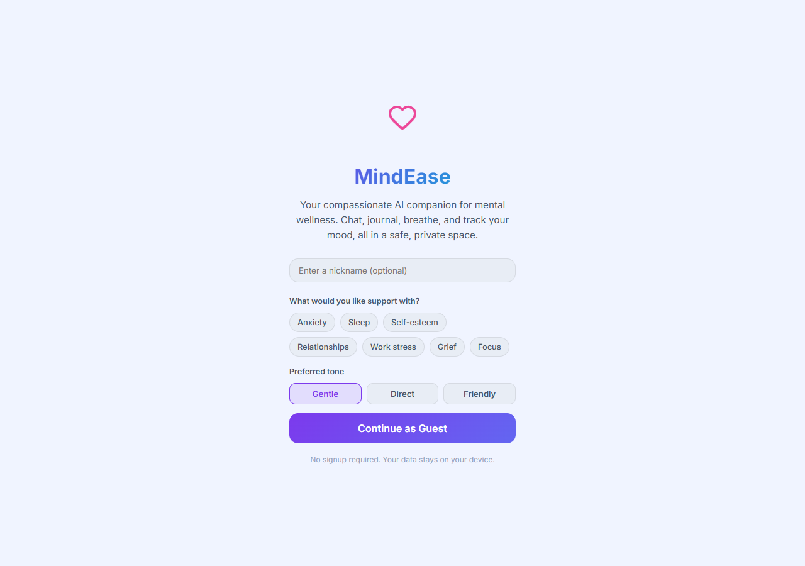

# MindEase

A privacy-first mental wellness companion built with React, Vite, and Groq.

Live demo: https://mindeasechat.vercel.app

MindEase helps you check in with yourself, talk things through with an AI companion, journal, and build small daily habits. All personal data stays in your browser.

## Screenshots

| Home | Chat |
| --- | --- |
|  |  |

| Insights | Onboarding |
| --- | --- |
|  |  |

More screenshots are in `docs/screenshots`.

## Features

- Daily check-in with a rotating prompt and a saved reflection
- Daily practice card with a micro exercise and a journal prompt
- AI chat powered by Groq (`qwen/qwen3.8-27b`) with a mental-health-focused system prompt
- Personalization: choose goals and a preferred tone during onboarding
- Journal with mood tags and a prompt handoff from Home
- Guided 4-7-8 breathing with a progress ring and ambient sound
- Weekly insights: mood trend chart, heatmap, and a downloadable recap image
- Wellness tasks with completion tracking
- Achievements and streak tracking
- Crisis resources and a calming breathing shortcut
- Light and dark themes
- Installable PWA with an offline app shell
- Export and import a local backup as JSON

## Tech stack

- React 19 and Vite
- Chart.js and react-chartjs-2
- lucide-react icons
- Groq API for chat
- Vercel serverless function for the API proxy
- localStorage for user data, no account required

## Architecture

- `src/main.jsx` boots the app and registers the service worker in production.
- `src/App.jsx` owns navigation and the localStorage-backed app state.
- `src/components` holds the screens: Home, Chat, Tasks, Insights, Journal, Breathing, Profile, Welcome, plus shared UI.
- `src/utils` holds pure logic: mood icons, emotion detection, system prompt, analytics, achievements, daily content, preferences, recap, API guards.
- `api/chat.js` is the Vercel function that proxies Groq. `server.dev.js` mirrors it locally.
- `src/utils/apiGuard.js` provides input caps, rate limiting, origin checks, and security headers shared by both API entry points.

## Getting started

```bash
npm install
cp .env.example .env
# then set GROQ_API_KEY in .env
npm run dev
```

Open http://localhost:5173. `npm run dev` runs the Vite UI and the local API on port 3001.

### Scripts

```bash
npm run dev        # UI and API
npm run dev:ui     # UI only
npm run dev:api    # API only
npm run build      # production build to dist/
npm run preview    # preview the build
npm run deploy     # deploy with the Vercel CLI
```

## Environment variables

| Variable | Description |
| --- | --- |
| `GROQ_API_KEY` | Groq API key used by the chat endpoint |
| `ALLOWED_ORIGINS` | Optional comma-separated allowlist for cross-origin API calls |

`.env.example` contains a placeholder only. Never commit a real key.

## Deployment

The project is set up for Vercel. Add `GROQ_API_KEY` in the Vercel project settings, then deploy. `vercel.json` configures the build, SPA rewrites, and security headers including a Content Security Policy.

## Security notes

- The API endpoint validates and caps input, applies a best-effort rate limit, checks the request origin, and sets security headers.
- CSP and other headers are defined in `vercel.json`.
- Chat messages are sent to Groq through the serverless function. Everything else stays in localStorage.
- For production use, add real authentication and edge rate limiting.

## Testing

There is no test runner in the repo yet. The app was verified with `npm run build`, Node syntax checks, and a Playwright walkthrough in Chrome covering onboarding, check-in, chat, tasks, journal, insights, breathing, and profile.

## Built with AI assistance

This project was built with heavy AI assistance. The commit history was reconstructed when publishing so the code is grouped into readable, logical changes.

## License

MIT. See `LICENSE`.
